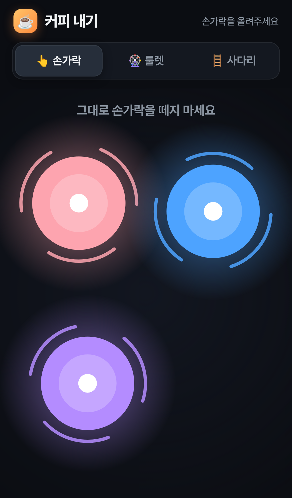
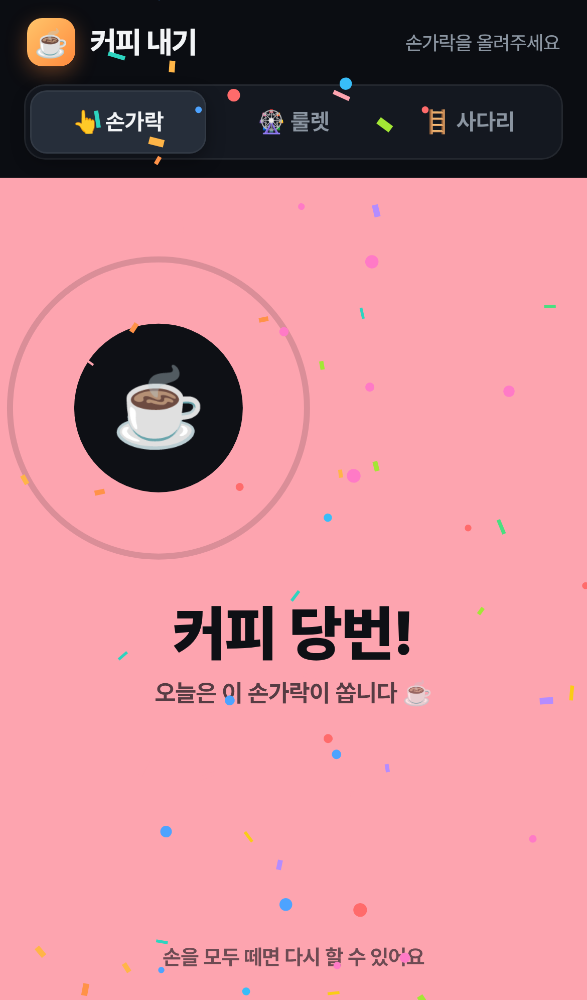
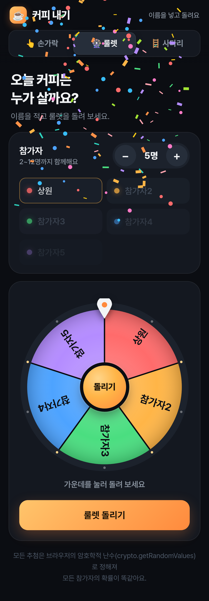

# ☕ 커피 내기

오늘 커피는 누가 살까요? 팀원끼리 휴대폰 하나로 커피 당번을 정하는 모바일 웹 게임입니다.
빌드 과정 없이 `index.html` 파일 하나로 돌아가고, 모든 추첨은 브라우저의 암호학적 난수(`crypto.getRandomValues`)로 공정하게 정해요.

**라이브:** https://coffee-bet-game.vercel.app

## 모드 3가지

| 모드 | 방법 |
| --- | --- |
| 👆 **손가락** | 다 같이 화면에 손가락을 올리면 손가락마다 색깔 원이 생겨 점점 커져요. 마지막으로 손가락이 바뀌고 약 3초가 지나면 한 명이 뽑히고, 그 원이 화면을 가득 채우며 **"커피 당번!"**이 떠요. 손가락을 더하거나 떼면 처음부터 다시 커지고, 한 명만 있으면 뽑지 않아요. |
| 🎡 **룰렛** | 참가자 이름(2~12명)을 적고 룰렛을 돌려요. 바늘이 멈춘 칸이 당번이에요. |
| 🪜 **사다리** | 매번 새로 만들어지는 사다리에서 이름을 탭하면 그 사람의 길을 따라가요. 아래 칸 하나에 ☕가 숨어 있어요. "전체 결과 보기"로 한 번에 확인할 수도 있어요. |

당첨되면 결과 화면과 함께 컨페티가 터지고, 지원하는 기기에서는 진동도 울려요.

## 스크린샷

| 손가락: 원이 커지는 중 | 손가락: 당번 결정 | 룰렛 |
| --- | --- | --- |
|  |  |  |

## 로컬에서 실행하기

파일 하나짜리 정적 사이트라 설치할 게 없어요.

```bash
# 브라우저로 바로 열거나
open index.html
# 간단한 정적 서버로 띄워서 휴대폰으로 접속
python3 -m http.server 8080
```

손가락 모드는 멀티터치가 되는 휴대폰에서 해 주세요.

## 테스트

`test/run.js`는 Playwright로 iPhone 13을 에뮬레이션해서 터치 이벤트로 게임 전체를 확인해요.
확인하는 것: 손가락 원이 계속 커지는지, 손가락이 바뀌면 리셋되는지, 3초 뒤에 뽑히는지, 룰렛 결과가 바늘이 가리킨 칸과 맞는지, 사다리, 가로 넘침, 콘솔 에러.

```bash
cd test
npm install
# Chrome/Chromium 경로가 /usr/bin/google-chrome 이 아니면 CHROME_PATH로 지정
CHROME_PATH="/Applications/Google Chrome.app/Contents/MacOS/Google Chrome" npm test
# 배포된 사이트를 테스트하려면
URL=https://coffee-bet-game.vercel.app npm test
```

스크린샷은 `test/screens/`에 저장돼요 (`SCREENS_DIR`로 바꿀 수 있어요).

## 배포

정적 파일이라 `index.html`만 올리면 돼요. 지금은 Vercel(정적, 프레임워크 없음)에 배포되어 있어요.
